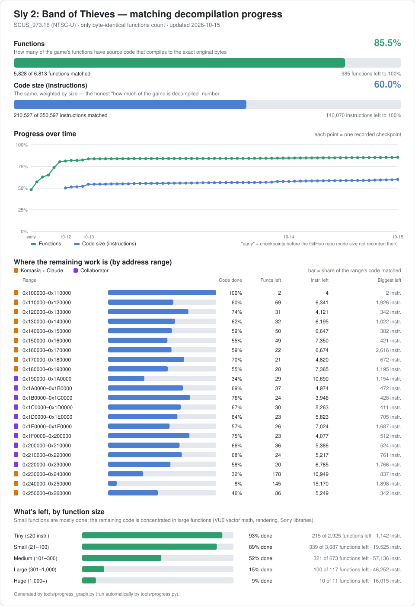

# Sly 2: Band of Thieves — matching decompilation

**Complete: all 6,662 functions match the original game byte for byte.**

This repo contains no game data; bring your own disc. **To build and check it, start with [SETUP.md](SETUP.md).**
Who did what: [CREDITS.md](CREDITS.md).

Target: `SCUS_973.16` (NTSC-U, SHA-1 de2af92a54de71e33edc8a160c31c0337a95e6f5)

## Progress

Only functions whose compiled bytes are identical to the original game count, and every call and data address in
them is checked against the original (relocation-aware check).

## Toolchain (confirmed)
- **Game code: ee-gcc 2.95.3 build 136**, flags `-O2 -G0 -ffast-math`, sources compiled as C++ (`-x c++`),
  assembled with the SN assembler `ps2eeas` from build 114 plus the short-loop filter in `tools/asfix.py`.
  (Sly 1 used SN ee-gcc 2.95.2 v2.73a; Sly 2 differs — it saves `$ra` with `sd`, not `sq`.)
- **Sony SDK libraries** (`src/lib/`) use other Sony-era compilers (ee-gcc 2.9x / 2.96 / 3.2); each file names its
  compiler and flags in a header comment (`SLY2_CC:`, `SLY2_CFLAGS:`, `SLY2_ASM:`).
- Runs on Linux through `tools/wibo-i686`. Compilers go in `tools/compilers/` (from decomp.me's collection; see SETUP.md).

## Layout
- `src/P2/*.cpp` — engine code with real types/names (e.g. `bis.cpp`, the binary input stream)
- `src/hand/` — hand-decompiled functions (one function per file, mostly address-based names)
- `src/auto/` — functions matched from m2c output (raw C, unknown types as `M2C_FIELD` macros)
- `src/splicewrap/` — wrappers for the Splice scripting runtime (generated by `tools/gen_splicewrap.py`)
- `src/lib/` — Sony SDK libraries (libkernel, libc, libm, libgraph, libpad, libmc, libmpeg, …)
- `include/` — headers (`bis.h`, `vec.h`, `mat.h`, `common.h`, `m2c_prelude.h`, …)
- `config/functions.csv` — every function's address/size; `config/symbol_addrs.txt` — names;
  `config/matched.csv` — verified match list (generated); `config/junk.csv` — dead-code scraps between functions
  (not functions); `config/progress_history.csv` — data for the graph
- `docs/MATCHING_NOTES.md` — compiler facts and the matching techniques used

## Tools
- `tools/matchtool.py check FILE [func...]` — compile one source and compare it to the original, per function
- `tools/progress.py` — rebuild every source, regenerate `config/matched.csv`, print totals, redraw the graph
- `tools/show.py NAME` — original assembly next to an m2c draft
- `tools/setup_all.sh` — fetch compilers and tools, extract the executable from your disc

Env for the tools: PYTHONPATH must include rabbitizer (`pip install rabbitizer spimdisasm splat64`).

## Not yet done
The code matches, but most functions still have address-based names (`func_XXXXXXXX`, `D_XXXXXXXX`) and m2c-style
types. Naming and cleanup can be done later without affecting the match.
